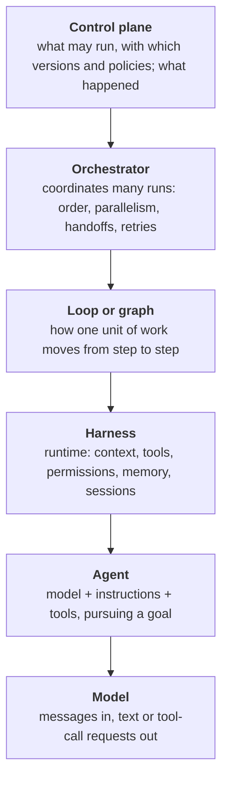
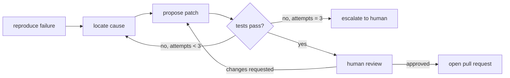
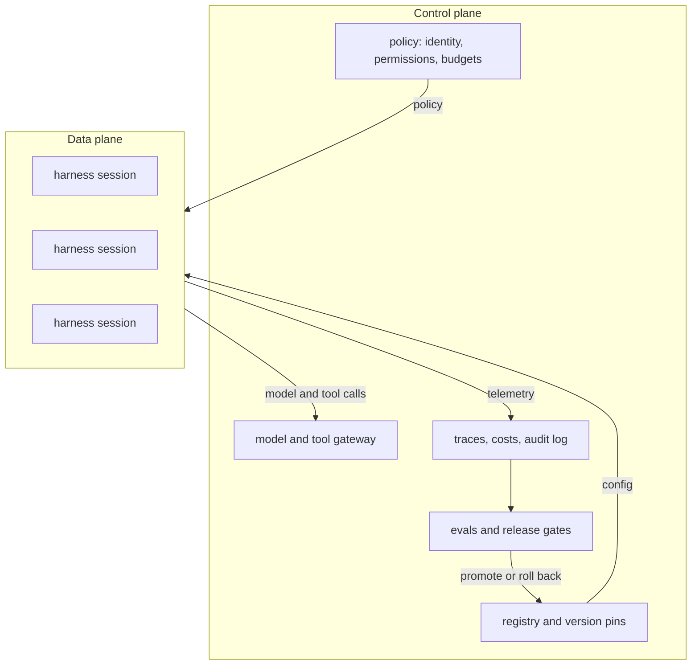
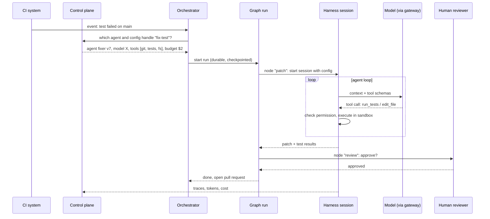

# The agent stack: a background for developers

"Agent" is one of the most overloaded words in software right now. One team uses it for a single prompt with a function call. Another uses it for a fleet of long-running workers with their own identities and budgets. Words like *harness*, *orchestrator* and *control plane* get stretched in the same way. The result is design reviews where people agree on the words and disagree on the systems.

This article gives each layer of an agentic system a **working definition**. The aim is not to settle every debate. It is to give developers a shared vocabulary that is precise enough to design, review and debug with. Each definition follows the same shape:

- **Definition**: one or two sentences you could put in a design doc.
- **What it is not**: the confusion the definition is meant to prevent.
- **In practice**: what it looks like in code, and open-source examples.

The rest of this knowledge base expands each definition into its own entry.

## The stack at a glance

Most agentic systems, from a coding assistant on a laptop to a platform running thousands of agent sessions, decompose into the same six layers. Each layer wraps the one below it.



| Layer | The question it answers | Typical artefacts |
|---|---|---|
| Model | What is the next best output given this context? | an LLM behind an API |
| Agent | What should I do next to reach the goal? | system prompt, tool set, stop conditions |
| Harness | How does the agent actually run? | agent CLI or SDK, sandbox, session store |
| Loop / graph | In what order do steps happen, and who decides? | a `while` loop, or a state-machine definition |
| Orchestrator | How do many agents or runs work together? | supervisor agent, workflow engine, reconciler |
| Control plane | What is allowed to run, and how do we know it worked? | registry, policies, gateway, traces, evals |

A small project might collapse several layers into one script. That is fine. The layers are still there, just implicit, and naming them tells you where a problem lives when something goes wrong.

## 1. Model

<div class="def">

**Model.** A large language model (LLM) is a stateless function from a context (messages, plus optional tool definitions) to an output: text, or a structured request to call a tool.

</div>

**What it is not.** A model does not *do* anything. When people say a model "called a tool", the model only emitted a structured request such as `{"tool": "read_file", "args": {"path": "src/app.ts"}}`. Some other piece of software decided to run it. A model also remembers nothing between calls: any "memory" is context that software put back into the next request.

**In practice.** You reach models through a provider API or a local runtime. For agents, the properties that matter most are tool-calling reliability, how well the model follows instructions over long contexts, the size of the context window, latency and cost.

## 2. Agent

<div class="def">

**Agent.** A system in which a model, given a goal, instructions and a set of tools, **repeatedly chooses its next action based on the results of its previous actions**, until it judges the goal is met or a stop condition fires.

</div>

The key property is that **the model controls the flow**. In a *workflow*, your code decides the sequence of steps, and the model fills in content at each step. In an *agent*, the model decides which step comes next. Anthropic's essay [Building effective agents](https://www.anthropic.com/engineering/building-effective-agents) popularised this workflow-versus-agent distinction, and it is the most useful single test for whether something is an agent.

An agent is made of five parts:

1. **A model**, which does the reasoning.
2. **Instructions**: the role, constraints and definition of done, usually in a system prompt.
3. **Tools**: functions the agent can request, such as reading files, searching, calling APIs or running code.
4. **State**: the conversation so far, plus any working memory.
5. **Stop conditions**: task complete, turn or budget limit reached, or a human interrupt.

**What it is not.** A chatbot that answers once is not an agent. A fixed chain of prompts is not an agent either, however many LLM calls it makes. Autonomy is a spectrum:

```
single call → prompt chain → router → agent loop → multiple agents
   (code decides everything)          (model decides more and more)
```

Move right only when the task needs it. Each step to the right buys flexibility and costs predictability, testability and money.

## 3. Harness

<div class="def">

**Harness.** The runtime that wraps a model and turns it into a working agent. It assembles the context for every model call, exposes tools and executes the calls the model requests, enforces permissions and sandboxing, manages sessions, memory and context-window compaction, and streams events to a user interface or API.

</div>

A useful slogan: **agent = model + harness**. The same model can be excellent in one harness and mediocre in another, because most of what users experience as "agent quality" depends on the harness: what goes into the context, which tools are available and how they are described, how errors are reported back to the model, and when old context is summarised or dropped.

| Harness responsibility | What it involves |
|---|---|
| Context assembly | system prompt, project instructions, relevant files, tool results, conversation history |
| Tool runtime | tool schemas, argument validation, execution, timeouts, result formatting |
| Permissions and sandboxing | which tools need approval; filesystem, network and process isolation |
| Session management | persist, resume and fork sessions; one session per task or per step |
| Memory and compaction | summarise or trim context as it approaches the window limit; long-term notes |
| Extension points | plugins, hooks, custom tools, protocol clients (for example MCP) |
| Interface | terminal UI, IDE, headless mode, SDK or RPC for other programs to drive it |

**What it is not.** A harness is not the same thing as a *framework*.

- A **framework** is a library you use to *build* an agent or workflow. Examples: [LangGraph](https://github.com/langchain-ai/langgraph), [Pydantic AI](https://github.com/pydantic/pydantic-ai), [smolagents](https://github.com/huggingface/smolagents).
- A **harness** is a ready-to-run agent runtime. Examples: [pi](https://github.com/earendil-works/pi), [OpenAI Codex CLI](https://github.com/openai/codex), [OpenHands](https://github.com/OpenHands/OpenHands), [goose](https://github.com/aaif-goose/goose), [Aider](https://github.com/Aider-AI/aider).

The line is blurring. Agent SDKs such as the [Claude Agent SDK](https://github.com/anthropics/claude-agent-sdk-python) and the [OpenAI Agents SDK](https://github.com/openai/openai-agents-python) package a harness as a library, so you can embed a complete agent runtime in your own program.

## 4. The agent loop

<div class="def">

**Agent loop.** The control structure at the heart of an agent: call the model, execute any tool calls it requests, append the results to the context, and repeat until the model answers without requesting a tool, or a limit is hit.

</div>

Stripped of everything else, most agents come down to about fifteen lines:

```python
def run_agent(goal, tools, model, max_turns=50):
    messages = [system_prompt(), user(goal)]
    for turn in range(max_turns):
        reply = model.generate(messages, tools=tools.schemas())
        messages.append(reply)

        if not reply.tool_calls:            # the model thinks it is done
            return reply.text

        for call in reply.tool_calls:        # the model asked to act
            if not permitted(call):
                result = "denied by policy"
            else:
                result = tools.execute(call)  # the harness acts, not the model
            messages.append(tool_result(call.id, result))

        messages = compact_if_needed(messages)
    raise TurnLimitExceeded()
```

The pattern goes back to **ReAct** ([Yao et al., 2022](https://arxiv.org/abs/2210.03629)), which interleaved reasoning ("thought") with actions and observations. Native tool-calling APIs later turned it into the default shape of an agent.

**Why the loop is powerful.** The model adapts. If a test fails, it reads the error and tries something else. It can take paths nobody planned for.

**Why the loop is risky.**

- **Compounding errors**: a wrong early assumption shapes every later step.
- **Runaway loops**: the agent repeats a failing action, or never decides it is done.
- **Context bloat**: tool output fills the window and pushes out the instructions.
- **Opacity**: the path is only known after the run, so testing means sampling many runs.

Stop conditions, turn and cost budgets, permission checks and compaction are what make the loop safe to run. That is why they belong to the harness, not the model.

## 5. Graph engineering

<div class="def">

**Graph engineering.** Designing an LLM application as an explicit graph. Nodes are steps (model calls, tool calls, plain code, human approvals). Edges are transitions, either fixed or conditional on state. A typed state object flows through the graph. **The engineer defines the control flow**, and the model works inside each node.

</div>

The term is not yet standardised. Related ideas appear as "agentic workflows", "state machines" and "flow engineering", a phrase used in the AlphaCodium paper ([Ridnik et al., 2024](https://arxiv.org/abs/2401.08500)). What they share is moving control flow out of the prompt and into code you can read, test and version.

A graph for "fix a failing test" might look like this:



In framework-neutral code:

```python
graph = Graph(state=FixState)          # typed state: repo, failure, patch, attempts...
graph.node("reproduce", run_tests)     # plain code, no LLM
graph.node("locate",    llm_step(locate_prompt))
graph.node("patch",     agent_step(coding_agent))   # an agent loop inside one node
graph.node("review",    human_approval)
graph.edge("reproduce", "locate")
graph.edge("locate", "patch")
graph.conditional("patch", lambda s: "review" if s.tests_pass
                           else "locate" if s.attempts < 3 else "escalate")
graph.checkpoint(store)                # resume after a crash or a human pause
```

Graph runtimes usually add the things a raw loop lacks: **checkpointing and resume**, **human interrupts** at chosen nodes, **parallel branches**, **bounded cycles**, and a **trace that matches the design**, so a failed run points to a specific node.

### Loop or graph?

| | Agent loop | Graph |
|---|---|---|
| Who decides the next step | the model | the engineer, via edges |
| Best for | open-ended tasks, unknown paths | known processes, compliance, repeatability |
| Predictability | low | high |
| Testability | statistical (many runs) | per node and per path |
| Failure mode | wanders, loops, drifts | too rigid, misses unplanned paths |
| Human control | interrupts and permissions | built into nodes and edges |

In practice the answer is usually **both**. A graph provides the skeleton and the checkpoints, and the steps that need real judgement are agent loops *inside* single nodes. A useful rule of thumb: **use a graph for the parts of the process you could write down in advance, and an agent loop for the parts you could not.**

## 6. Orchestrator

<div class="def">

**Orchestrator.** The component that coordinates multiple units of agentic work (agents, agent sessions or graph runs). It decides what runs, in what order or in parallel, how work and context are handed between units, and how failures are retried, compensated or escalated.

</div>

As soon as you have more than one agent, or one agent that must survive restarts, you have an orchestration problem. Common patterns:

| Pattern | Shape | Good for |
|---|---|---|
| **Supervisor / worker** | a lead agent splits work and delegates to sub-agents | research, broad searches, large refactors |
| **Handoff** | one agent passes control, with context, to a specialist | triage then specialist; front desk then expert |
| **Pipeline** | fixed stages, each owned by one agent | requirements, then design, then code, then review |
| **Fan-out / fan-in** | the same task in parallel, results merged or voted on | reliability, exploring alternatives |
| **Evaluator / optimiser** | one agent generates, another critiques, repeat | writing, code quality, spec quality |
| **Reconciler** | a controller watches desired vs actual state and starts work to close the gap | long-lived, event-driven systems |

The **reconciler** pattern is borrowed from [Kubernetes controllers](https://kubernetes.io/docs/concepts/architecture/controller/). The orchestrator is stateless: all state lives in something durable, such as a database, a queue or a git repository. Each tick asks "what should exist that doesn't yet?" and starts the agent run that would produce it. Crashes are cheap, because the next tick simply resumes.

The hard problems of orchestration are rarely about the LLM:

- **Durable execution.** Agent runs take minutes to days. Workflow engines such as [Temporal](https://github.com/temporalio/temporal), [Restate](https://github.com/restatedev/restate) and [DBOS](https://github.com/dbos-inc/dbos-transact-py) persist every step so a run survives crashes and deploys.
- **Idempotency.** A retried step must not send the email twice or open two pull requests.
- **Context passing.** Decide what each sub-agent sees. Too little and it guesses; too much and it drowns.
- **Human-in-the-loop.** Pause for approval, possibly for days, then resume exactly where the run left off.
- **Concurrency and cost.** Limit parallel sessions and budgets across the whole run, not per agent.

**What it is not.** The orchestrator is *not* necessarily a graph. A graph is one way to express orchestration, and so is plain code, a durable workflow, a reconciler, or an LLM acting as supervisor. Multi-agent frameworks such as [CrewAI](https://github.com/crewAIInc/crewAI), [AutoGen](https://github.com/microsoft/autogen) and [LangGraph](https://github.com/langchain-ai/langgraph) each bundle an opinion about which to use. The orchestrator is also not the control plane: it runs the work, but does not decide what work is allowed.

## 7. Control plane

<div class="def">

**Control plane.** The management layer that governs a *fleet* of agents rather than running any single one. It holds the desired configuration (which agents, models, prompts, tools and versions), enforces policy (identity, permissions, budgets, guardrails), and collects the telemetry and evaluation results needed to change that configuration safely.

</div>

The term comes from networking and Kubernetes, which split a system into two planes:

- The **data plane** does the work. For agents, that is harness sessions running loops and graphs.
- The **control plane** decides how the work should be done, and observes whether it was.



| Responsibility | Why agents need it |
|---|---|
| **Registry and pinning** | Agent behaviour depends on model, prompt, tools *and* harness version. Pin them together, as you would with a lockfile. |
| **Identity and access** | Agents act on real systems. Each needs its own identity and least-privilege access to tools and data. |
| **Model gateway** | One place for routing, fallbacks, rate limits, keys and cost accounting, for example [LiteLLM](https://github.com/BerriAI/litellm). |
| **Tool and protocol gateway** | Centralised authorisation and logging of tool and agent-to-agent traffic, for example [agentgateway](https://github.com/agentgateway/agentgateway). |
| **Policy and guardrails** | Input and output checks, forbidden actions, approval requirements, for example [NeMo Guardrails](https://github.com/NVIDIA-NeMo/Guardrails). |
| **Observability** | Traces of every model and tool call, following the [OpenTelemetry GenAI conventions](https://opentelemetry.io/docs/specs/semconv/gen-ai/); tools include [Langfuse](https://github.com/langfuse/langfuse) and [Phoenix](https://github.com/Arize-ai/phoenix). |
| **Evals and release gates** | A new prompt or model version ships only when it meets thresholds on a test suite, for example with [promptfoo](https://github.com/promptfoo/promptfoo). |
| **Audit** | Who, or which agent, did what, with which configuration, and who approved it. |

**What it is not.** The control plane does not choose an agent's next step (that is the loop or graph). It does not schedule the next run either (that is the orchestrator). A useful test: *if the control plane goes down, running agents should keep working with their last known configuration; you just can't change or observe them.* Projects such as [kagent](https://github.com/kagent-dev/kagent) take this literally, declaring agents as Kubernetes resources.

A control plane does not have to be a product. For a small team, a pinned configuration file in git, a model gateway, tracing and an eval job in CI already make up a control plane.

## Supporting concepts

These appear at several layers. Each will get its own KB entry.

| Term | Working definition |
|---|---|
| **Tool** | A function exposed to the model through a name, a description and an input schema. The harness executes it. |
| **Tool calling** | The model emits a structured request to invoke a tool, and the result comes back as a new message. |
| **MCP** | The [Model Context Protocol](https://modelcontextprotocol.io): an open protocol through which a harness discovers and calls tools, resources and prompts served by external processes. It connects an agent to its tools. |
| **A2A** | The [Agent2Agent protocol](https://a2a-protocol.org/): an open protocol for agents to discover each other and exchange tasks. It connects agents to other agents. |
| **Context engineering** | Deciding what goes into the model's context window at each step, and what stays out. Most harness quality lives here. |
| **Memory** | *Short-term*: the current session's context. *Long-term*: facts or notes stored outside the context and retrieved when needed. |
| **Compaction** | Summarising or trimming old context so a long session fits the window without losing the plot. |
| **Sub-agent** | An agent started by another agent with its own fresh context, returning only a result. Used to isolate context and to work in parallel. |
| **Sandbox** | An isolated environment (container, VM, restricted process) where tool calls with side effects run, for example [E2B](https://github.com/e2b-dev/E2B). |
| **Guardrail** | A check outside the model that blocks, rewrites or escalates inputs, outputs or actions. |
| **Human-in-the-loop** | A designed point where a person approves, edits or rejects before work continues. |
| **Eval** | A repeatable test of agent behaviour, scored by code, by people, or by another model. |
| **LLM-as-judge** | An eval that uses a model, ideally different from the one being tested, to score outputs against a rubric. |
| **Model gateway** | A proxy in front of every model call for routing, keys, limits, fallbacks and cost tracking. |

## Walkthrough: one request through the stack

Here is how the layers work together, with a CI test failure that an agent should fix.



1. **Control plane.** It resolves *which* agent handles the event and pins its model, prompt, tools, harness version and budget.
2. **Orchestrator.** It starts a durable run and will retry or resume it if a worker dies.
3. **Graph.** It walks reproduce, then locate, then patch, then review. The control flow is fixed and visible.
4. **Harness.** Inside the `patch` node it runs an agent loop, assembling context, executing tools in a sandbox and checking permissions.
5. **Model.** It proposes each next action. It never touches the repository directly.
6. **Human.** The reviewer approves at the node the graph reserved for them.
7. **Telemetry** flows back to the control plane, where evals decide whether `fixer v8` is safe to promote.

When the run goes wrong, the layers tell you where to look. A bad edit points to the model or context engineering (harness). An endless retry points to the graph or orchestrator. An agent touching something it shouldn't points to the control plane's policy.

## Glossary

| Term | One line |
|---|---|
| Model | Stateless function: context in, text or tool-call requests out. |
| Agent | A model repeatedly choosing its next action toward a goal, using tools. |
| Harness | The runtime that turns a model into an agent: context, tools, permissions, sessions. |
| Agent loop | Call model, run requested tools, feed back results, repeat until done. |
| Graph engineering | Designing control flow as explicit nodes, edges and state, not leaving it to the model. |
| Orchestrator | Coordinates many agent runs: order, parallelism, handoffs, retries, durability. |
| Control plane | Governs the fleet: configuration, versions, policy, identity, telemetry, evals. |
| Data plane | Where agent work actually executes: harness sessions. |

## Open-source starting points

These are examples to explore, not endorsements. Every project is linked to its source repository. The [knowledge base](/kb/) will add a full entry for each.

| Layer | Projects |
|---|---|
| Harness | [pi](https://github.com/earendil-works/pi) · [Codex CLI](https://github.com/openai/codex) · [OpenHands](https://github.com/OpenHands/OpenHands) · [goose](https://github.com/aaif-goose/goose) · [Aider](https://github.com/Aider-AI/aider) |
| Agent SDK | [Claude Agent SDK](https://github.com/anthropics/claude-agent-sdk-python) · [OpenAI Agents SDK](https://github.com/openai/openai-agents-python) · [Pydantic AI](https://github.com/pydantic/pydantic-ai) · [smolagents](https://github.com/huggingface/smolagents) |
| Graph and multi-agent | [LangGraph](https://github.com/langchain-ai/langgraph) · [CrewAI](https://github.com/crewAIInc/crewAI) · [AutoGen](https://github.com/microsoft/autogen) |
| Durable orchestration | [Temporal](https://github.com/temporalio/temporal) · [Restate](https://github.com/restatedev/restate) · [DBOS](https://github.com/dbos-inc/dbos-transact-py) |
| Protocols | [MCP](https://github.com/modelcontextprotocol/modelcontextprotocol) · [A2A](https://github.com/a2aproject/A2A) |
| Gateways | [LiteLLM](https://github.com/BerriAI/litellm) · [agentgateway](https://github.com/agentgateway/agentgateway) |
| Control plane | [kagent](https://github.com/kagent-dev/kagent) |
| Observability | [Langfuse](https://github.com/langfuse/langfuse) · [Phoenix](https://github.com/Arize-ai/phoenix) |
| Evals and guardrails | [promptfoo](https://github.com/promptfoo/promptfoo) · [NeMo Guardrails](https://github.com/NVIDIA-NeMo/Guardrails) |
| Sandboxes | [E2B](https://github.com/e2b-dev/E2B) |

## Further reading

- Yao et al., [ReAct: Synergizing Reasoning and Acting in Language Models](https://arxiv.org/abs/2210.03629) (2022). The origin of the agent loop.
- Anthropic, [Building effective agents](https://www.anthropic.com/engineering/building-effective-agents). The workflow-versus-agent distinction and common patterns.
- Ridnik et al., [AlphaCodium: From Prompt Engineering to Flow Engineering](https://arxiv.org/abs/2401.08500) (2024). An early argument for explicit flows.
- [Kubernetes controllers](https://kubernetes.io/docs/concepts/architecture/controller/). The reconciler and control-plane ideas this article borrows.
- [OpenTelemetry semantic conventions for GenAI](https://opentelemetry.io/docs/specs/semconv/gen-ai/). The emerging standard for agent traces.

---

*Disagree with a definition? That is the point of writing them down. Use "Suggest a change to this page" below, or open an issue.*
